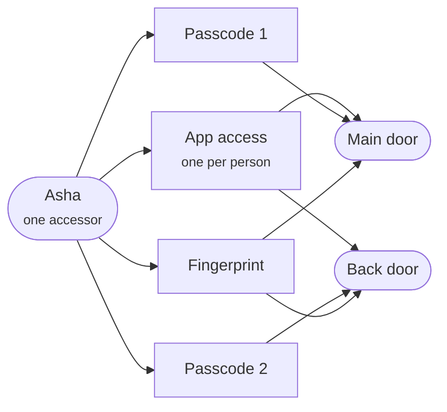

# Multiple Locks & Passcodes

What changes in the IoT9 B2C flows so that one property can hold **several locks**, and one person can hold **several passcodes**: one for each lock.

## What this reference is

Your own documentation site records every Spintly SDK member and backend endpoint the app touches today, flow by flow. This site follows the same pages, in the same order, and says for each one **what changes, what is new, and what stays as it is**.

Read it next to your own pages:

- every flow page here has the same number and name as yours, and its steps keep your step numbers
- each step carries a badge: new changed unchanged
- the diagrams use your participants and colours, so a diagram here can be laid next to yours
- every flow is drawn in full, including steps that do not change, so each page can be read on its own

## Why it changes

Today a person has **one credential** in a property, and access is granted to the **person**. A passcode belongs to the credential, so one person meant one passcode, valid on every lock they could open. That is why a property was limited to a single lock: a second lock would have accepted the first lock's passcode.

That is no longer the case:

- A person can hold **several credentials**, and each passcode credential carries **its own passcode**.
- Access is granted **per credential, per lock**. You decide which credential goes on which lock, and therefore which passcode opens which lock.

Asha opens both doors from the app and with her fingerprint, but each door has its own passcode. Each lock gets a fresh passcode credential: for a second lock, Asha gets a second passcode credential.

## What changes at a glance

| Area | Today | After |
|---|---|---|
| Locks per property | One | Many |
| Credentials per person | One | Many: one app credential and one fingerprint credential, plus as many passcode and card credentials as you need |
| How access is granted | To the person, on a lock | To a **credential**, on a lock |
| Passcodes | One per person, valid on every lock | **A fresh passcode credential for each lock.** A passcode is never copied between locks, so changing one never affects another |
| Sync signals | `resource_alive` for the organisation, `site_create` for the property | `resource_alive` for **every** resource: organisation, site, network and access point |
| Admin and dual authentication | Set per lock on the permission call | Set **per person** across the organisation, on access settings |
| Schedules | Several per person on one lock | **One per person per lock**. Different locks can carry different schedules, or share one |
| Config SDK | Current release | **Config SDK v3**: the device is found by serial number, and the passcode and fingerprint members take a `credentialId` |

## Which pages change

| Page | What changes |
|---|---|
| [1. User Onboarding](user-onboarding.md) | Nothing |
| [2. Lock Onboarding](lock-onboarding.md) | Sync signals, owner's credentials, binding them to the lock, Config SDK v3 throughout |
| [3. Home](home.md) | Nothing in the calls. A lock shows only while the person has a credential on it |
| [4. Lock Control Panel](lock-control-panel.md) | Nothing |
| [5. User Management](user-management.md) | Accepting, granting methods, scheduled users, removing someone from a lock |
| [6. Activity Trail](activity-trail.md) | Nothing |
| [7. Lock Settings](lock-settings.md) | My Access, Remove Device, and the Config SDK v3 members |
| [8. Notifications](notifications.md) | Nothing |
| [9. Profile and Account](profile-and-account.md) | Nothing in the calls. Existing properties are moved to the new model together with you |

The new and changed Spintly endpoints are collected in [Spintly API changes](api-changes.md), and every Config SDK member that changes is mapped in [Config SDK v3](config-sdk-v3.md).

!!! info "Credential"

    Spintly's word for something a person opens a door with: the app, a passcode, a fingerprint, or a card. Every credential has a `credentialId`. A person (an **accessor**) can hold several, and the `credentialId` is what you now pass wherever a lock is told who may open it.

!!! warning "Some names are still provisional"

    The Config SDK v3 member names, the iOS signatures and a few details are still being confirmed. Each one is marked where it appears, and all of them are listed in [Still to be confirmed](pending.md).
