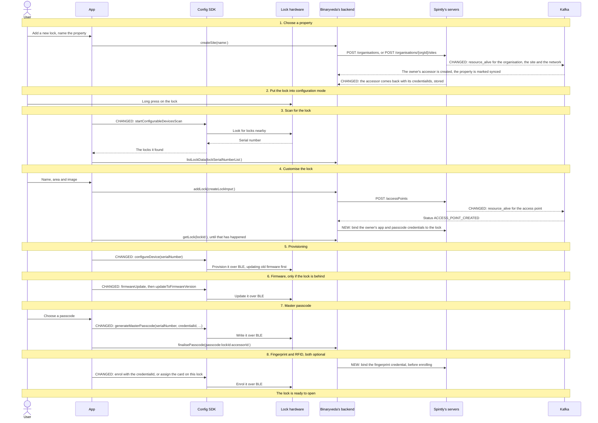
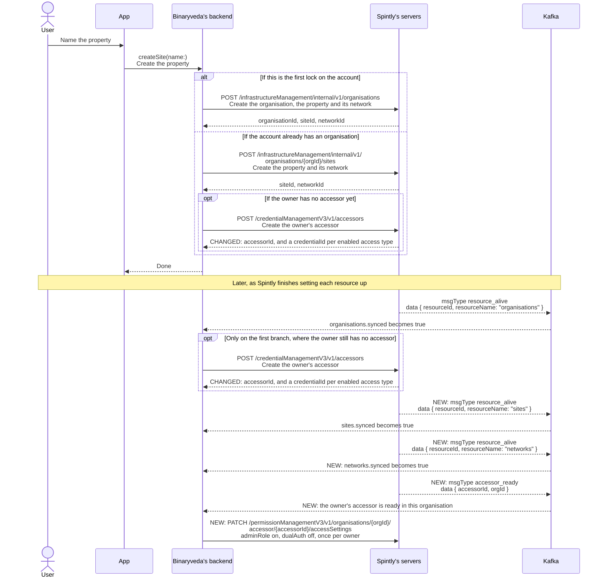
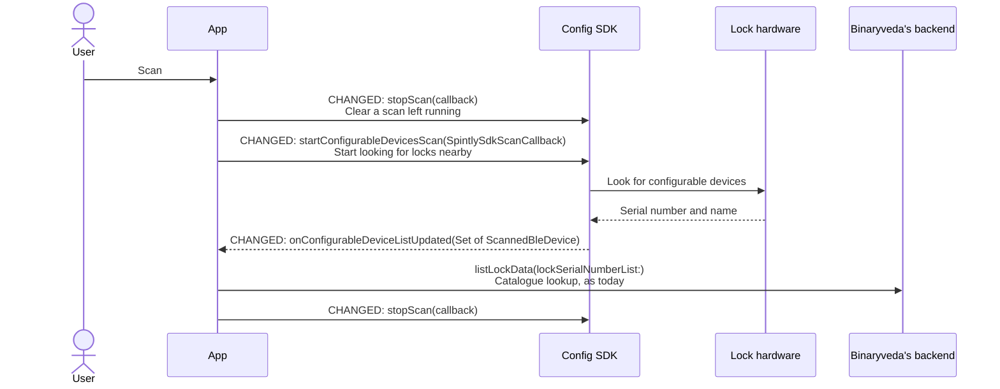
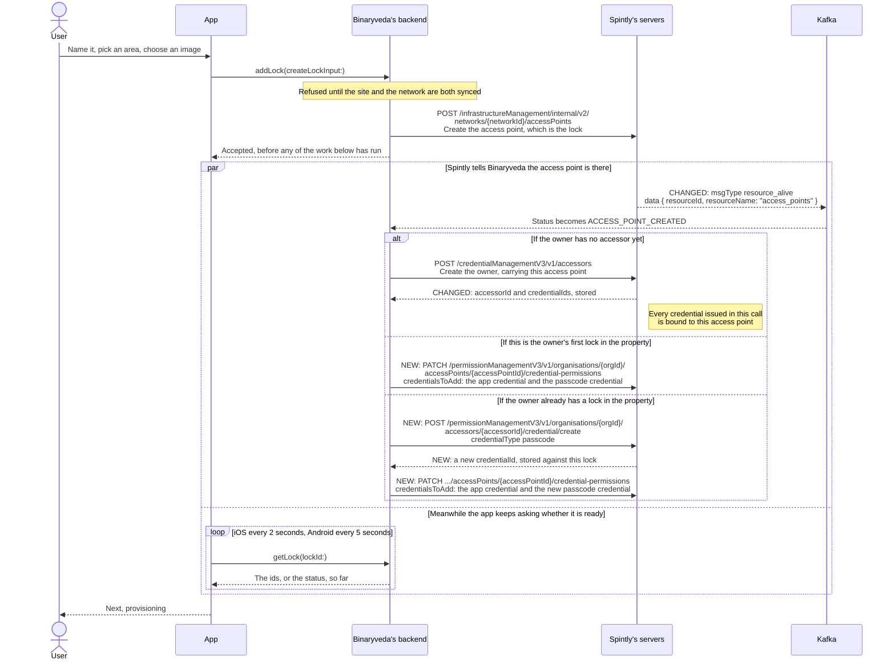
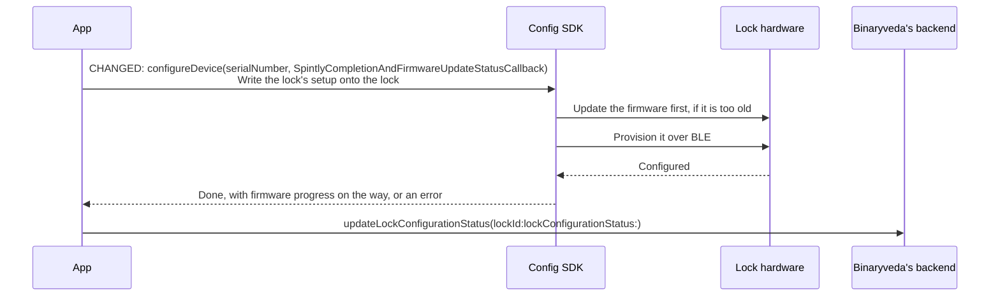
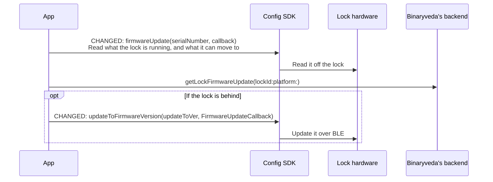
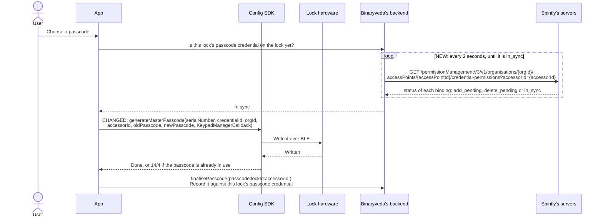
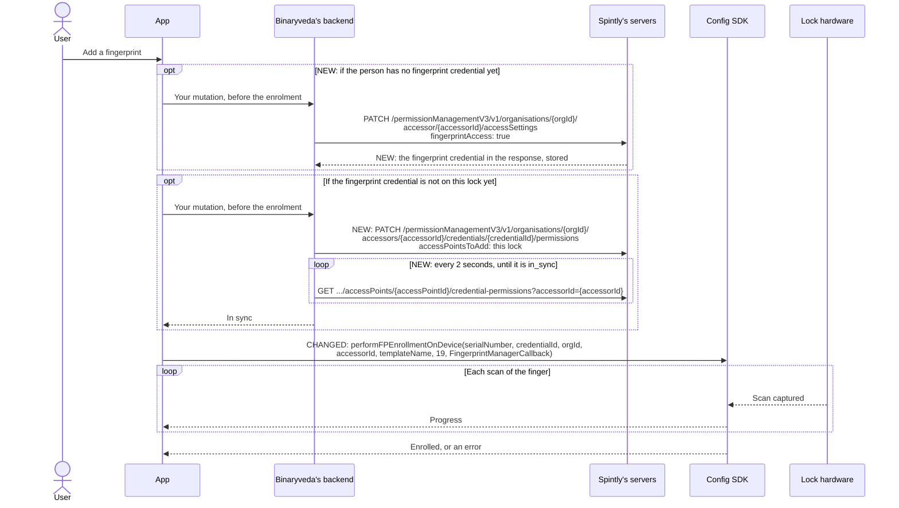
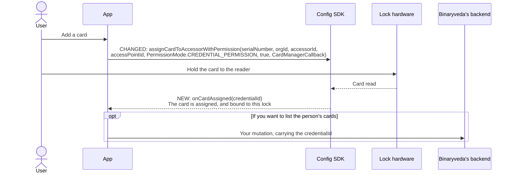

# 2. Lock Onboarding

**What it is.** Your Lock Onboarding flow, with the changes needed for a property to hold more than one lock, and for each lock to have its own passcode. The eight steps keep your numbering.

!!! warning "Key point"

    The owner is no longer given "permissions on the lock". Their **credentials are bound to the lock**: the app credential and a passcode credential in step 4, a fingerprint credential just before it is enrolled, and a card as it is scanned. The `credentialId` of the passcode bound in step 4 is what the master passcode call needs in step 7.

!!! info "Two waits move to new Kafka messages"

    | | What the app is waiting for | Today | After |
    |---|---|---|---|
    | Step 1, Choose a property | The property to become usable | `resource_alive` for the organisation, then `site_create` | `resource_alive` for the **organisation**, the **site** and the **network** |
    | Step 4, Customise the lock | `accessorId` on iOS, `ACCESS_POINT_CREATED` on Android | `access_point_create` | `resource_alive` for the **access point** |

    Every Spintly resource is marked synced on **its own** `resource_alive`. `site_create` and `access_point_create` are no longer what you wait on.

## What changes

| Step | | What changes |
|---|---|---|
| 1. Choose a property | <span class="chg chg-changed">changed</span> | Site and network each get their own `resource_alive`. The owner's accessor comes back with its credentials, which you store |
| 2. Configuration mode | <span class="chg chg-unchanged">unchanged</span> | |
| 3. Scan | <span class="chg chg-changed">changed</span> | Config SDK v3 scan members |
| 4. Customise the lock | <span class="chg chg-changed">changed</span> | Wait on the access point's `resource_alive`. Bind the owner's credentials to the lock instead of granting permissions. A second lock gets its own passcode credential |
| 5. Provisioning | <span class="chg chg-changed">changed</span> | `configureDevice(serialNumber, …)`, which also updates old firmware |
| 6. Firmware | <span class="chg chg-changed">changed</span> | Config SDK v3 firmware members, or folded into step 5 |
| 7. Master passcode | <span class="chg chg-changed">changed</span> | `generateMasterPasscode` takes the `credentialId` bound in step 4 |
| 8. Fingerprint and RFID | <span class="chg chg-changed">changed</span> | Fingerprint: bind, then enrol with the `credentialId`. Card: the SDK binds it to this lock and returns its `credentialId` |

## Participants

This page uses User, App, Config SDK, Lock hardware, Binaryveda's backend, Spintly's servers, and Kafka, as defined in [Reading these pages](conventions.md).

## The whole flow



## 1. Choose a property <span class="chg chg-changed">changed</span> { #1-choose-a-property data-toc-label="1. Choose a property" }

Same screens, same `createSite`, and the same two branches on your backend. Two things change behind them: **three** `resource_alive` messages mark the property usable instead of one plus `site_create`, and the accessor you create for the owner now hands back the owner's **credentials**.



**Store every `credentialId` the accessor call returns.** It returns one credential per access type enabled for the owner: the app credential, a passcode credential, a fingerprint credential, and so on. You will bind them to the lock in step 4, and the passcode one is what step 7 writes. If one is lost, read it back with `GET .../accessors/{accessorId}/credential` (see [Spintly API changes](api-changes.md#reading-a-persons-credentials)).

**The accessor still waits only for the organisation.** Nothing about when you create it changes. What changes is what `addLock` in step 4 has to wait for: the **site and the network** must both be synced, so the property's `synced` flag should now mean both `resource_alive` messages have arrived.

**`accessor_ready`** says the accessor now exists in that organisation and can have credentials bound. Bind nothing for an accessor before it arrives.

**Admin role and dual authentication move off the lock.** Today step 4's permission call turns admin on and dual authentication off for the new lock. Both are now set **once per person, for the whole organisation**, on that person's access settings. For the owner: `adminRole` on, `dualAuth` off. You can send them in the access settings of the accessor call itself, or afterwards with the `PATCH` shown.

!!! note "One message shape for every resource"

    ```json
    {
      "messageVersion": 1,
      "messageData": {
        "requestId": "ahds-akjshak-dsbdk-skjdskd",
        "msgType": "resource_alive",
        "dataVersion": 1,
        "data": { "resourceId": 123, "resourceName": "networks" }
      }
    }
    ```

    `resourceName` is one of `organisations`, `sites`, `networks`, `gateways`, `access_points`. `accessor_ready` uses the same envelope with `data: { "accessorId": 107968, "orgId": 123 }`. Handle both idempotently: the same message can arrive more than once.

## 2. Put the lock into configuration mode <span class="chg chg-unchanged">unchanged</span> { #2-put-the-lock-into-configuration-mode data-toc-label="2. Put the lock into configuration mode" }

The app does nothing on this screen. A factory fresh lock stays silent over BLE until someone puts it into configuration mode by hand: remove the back panel, hold the button marked **R** for 3 seconds, and wait for the sound cue. Only then will it answer a scan.

So this step is instructions and a **Scan** button. No SDK, no Binaryveda's backend, no Spintly.

## 3. Scan for the lock <span class="chg chg-changed">changed</span> { #3-scan-for-the-lock data-toc-label="3. Scan for the lock" }

The same scan, through the Config SDK v3 members. Nothing else in the step changes.



`ScannedBleDevice.getSerialNumber()` can be **null**. Skip such entries rather than sending them to `listLockData`.

A lock-only scan, `startConfigurableDevicesScan(SpintlyDeviceType.LOCK, callback)`, is an open point in the SDK. When it ships, the gateway filtering both apps do today is no longer needed.

## 4. Customise the lock <span class="chg chg-changed">changed</span> { #4-customise-the-lock data-toc-label="4. Customise the lock" }

The screens and `addLock` are unchanged. What `notification-service` does when the access point exists is what changes: it now **binds the owner's credentials to the lock**, and it does so off the access point's `resource_alive`.

There are now three cases rather than two, because a second lock needs a passcode of its own.



**The permission call is gone.** `PATCH .../accessors/{accessorId}/permissions` is refused for properties on the new model. Binding the app credential is what gives the owner the lock in the app, and binding a passcode credential is what lets step 7 write a passcode for it.

**Use a fresh passcode credential for every lock.**

- On the owner's **first** lock in a property, bind the passcode credential that came back with the accessor. It is not on any lock yet.
- On **every later lock**, request a new one with `credential/create`, as in the third branch above, and bind that.

**A passcode is never copied between locks.** Spintly does not stop a credential from being bound to more than one lock, but a passcode only exists on the lock it was written to. If a passcode credential were bound to two locks, its passcode would still work on only the one where it was set. Giving every lock its own credential keeps this simple: each lock's passcode belongs to that lock's credential, and changing it never touches another lock.

A person can still choose the **same digits** on two locks. They are two separate passcodes that happen to match: changing one later does not change the other.

**Store the passcode `credentialId` against the lock.** Every later passcode call for this lock (step 7, and My Access in Lock Settings) passes it. Today's lookup with `spintlyDetails(lockSerialNumber:)` returns `organisationId`, `accessorId` and `accessPointId`. It should now return the lock's passcode `credentialId` as well.

**The fingerprint credential is not bound here.** It is bound just before a finger is enrolled, in step 8, unless the accessor was created in this step, in which case it is already bound.

!!! note "Resuming an interrupted onboarding"

    `resumeOnboarding` walks the same synced flags, so it needs the site and network flags added. Its last step, today "the accessor or permission only once the access point is synced", becomes "the accessor or the credential binding only once the access point is synced". A binding that is repeated is harmless, so a resumed onboarding can safely send it again.

## 5. Provisioning <span class="chg chg-changed">changed</span> { #5-provisioning data-toc-label="5. Provisioning" }



**The SDK finds the lock by its serial number.** There is no session to open or close: `meshConfigurationClose()` no longer exists.

**An already configured lock fails with `2/56`.** Today Android ignores `domain 2 / code 24` for this case. Both platforms should treat `2/56` the same way.

## 6. Firmware <span class="chg chg-changed">changed</span> { #6-firmware data-toc-label="6. Firmware" }

Step 5 now updates firmware that is too old to be configured, so this step is only needed to move a lock to a **newer** version than that.



`updateToVer` is `getPdSwVer()` of the version picked from `firmwareUpdate`'s list. Until the next major SDK version this call is still named `updateToFwVersion`, with the same arguments.

If you always want a minimum version during onboarding, `configureDeviceWithMinimumFirmware(serialNumber, minimumFirmwareVersion, callback)` does steps 5 and 6 in one call. `minimumFirmwareVersion` is an `int` in the same form as `getPdSwVer()`, for example `66816` for `01.05.00`.

## 7. Master passcode <span class="chg chg-changed">changed</span> { #7-master-passcode data-toc-label="7. Master passcode" }



**`credentialId` is the passcode credential bound to this lock in step 4.** A credential that is not bound to this lock does not produce a working passcode.

**Wait until that binding is `in_sync` before writing.** Step 4's binding reaches the lock in the background, and the SDK refuses a passcode for a credential that is not on the lock yet. Check it with the `GET` shown, as described in [When a binding reaches the lock](api-changes.md#when-a-binding-reaches-the-lock). By the time provisioning and firmware have finished it is usually already `in_sync`.

**One member on both platforms.** iOS's `updateMasterPasscode` and Android's `generateMasterPasscode` become `generateMasterPasscode` on both. A duplicate passcode fails with **`14/4`** on both, so iOS no longer needs to read the error message.

Progress arrives as `CONNECTED`, `VERIFYING`, `SENDING_TO_DEVICE`, `SYNCING`.

The new passcode applies to **this lock only**, because this lock's passcode credential is not on any other lock.

## 8. Fingerprint and RFID <span class="chg chg-changed">changed</span> { #8-fingerprint-and-rfid data-toc-label="8. Fingerprint and RFID" }

### Fingerprint

**Make sure the person has a fingerprint credential, bind it, wait until it is `in_sync`, then enrol.** The fingerprint credential has to be on the lock before a finger is enrolled for it. Enrolling while the binding is still `add_pending` fails with `6/46`.

**A person may not have a fingerprint credential yet.** It is only created when fingerprint is enabled on their access settings. If fingerprint was not enabled when their accessor was created, there is no fingerprint credential until you enable it:

1. Enable fingerprint on the person's access settings: `PATCH …/accessor/{accessorId}/accessSettings` with `{ "fingerprintAccess": true }`. The first time fingerprint is enabled for them, this creates the credential, and the response returns it (see [Access settings](api-changes.md#access-settings)). Store its `credentialId`.
2. Bind it to this lock and wait until it is `in_sync`, as below.

Disabling and re-enabling fingerprint later does not create another one, so a person keeps the same fingerprint credential.



**`credentialId` is the person's fingerprint credential.** A person has exactly **one**, and it is reused on every lock: bind it to each lock they enrol a finger on.

**Fingers are enrolled lock by lock.** A finger enrolled on one lock is stored on that lock only, and is not copied to the person's other locks. To use the same finger on a second lock, enrol it there as well. Each enrolment is a separate fingerprint (template) with its own `templateDataId` and door, so a person can choose which finger opens which lock.

#### One fingerprint credential, many fingers { #one-fingerprint-credential-many-fingers }

Unlike passcodes, a person never needs a second fingerprint credential. A passcode credential *is* its digits, so a different passcode on each lock needs a different credential. A fingerprint credential only ties the person's fingers to them. The fingers themselves are the enrolments, and each enrolment belongs to one lock. Everything a person can want from their fingerprints is done with the one credential:

| The person wants | Do this |
|---|---|
| Different fingers on different locks | Enrol each finger on the lock it should open |
| The same finger on several locks | Enrol it on each of those locks |
| Stop one finger on one lock | Delete that fingerprint: `deleteFingerprintTemplatePermission(…, templateDataId, …)` |
| Stop all fingerprints on one lock | Unbind the fingerprint credential from that lock. Every finger enrolled there stops opening it |
| Different times on different locks | Give each lock its own schedule. A schedule covers everything the person has on that lock, fingerprints included |

`credential/create` therefore does not create fingerprint credentials. Bind the one the person already has.

**The timeout drops to 19 seconds**, from 60. ImageMatch fingerprint devices need a real `credentialId`, greater than 0. The SDK no longer needs `scanAndConnectFingerprintDevice` or `fingerprintClose()`.

### RFID

**No API call, and no `credentialId` to supply.** The card's id is not printed on it, so the SDK reads it, assigns the card to the person, and **binds it to the lock you pass**.



**Use `CREDENTIAL_PERMISSION`.** The card then opens this lock in its own right. `ACCESSOR_PERMISSION` is the old person-level mode and fails with `7/55` on the new model.

`scanAndConnectCardDevice`, `nfcEnrollmentStopScan()` and `nfcEnrollmentClose()` no longer exist.

### Where each access method ends up

| Access method | On the lock | At Spintly | Saved on Binaryveda's backend |
|---|---|---|---|
| Master passcode | Yes | Its passcode credential, bound to this lock | Yes, through `finalisePasscode`. **Add the `credentialId`** |
| Fingerprint | Yes | The fingerprint credential, bound to this lock | Optional |
| RFID card | Yes | A card credential, bound to this lock | Optional. You now receive its `credentialId`, so `assignRfid` can carry it |

## Second and later locks

Every lock after the first runs the same eight steps. Only step 1 and step 4 behave differently, and both are already shown above:

- **Step 1** usually does nothing: the user picks an existing property, which is already synced.
- **Step 4** takes the third branch: a new passcode credential for the lock from `credential/create`, then the binding.

Steps 7 and 8 then use **this lock's** passcode credential and the person's fingerprint credential.

## Where the flow ends

Finish closes onboarding and drops the user on Home, with the lock they just built on it.

## Differences between the two

The v3 Config SDK removes several of today's differences.

| | Today | After |
|---|---|---|
| Master passcode SDK member | iOS `updateMasterPasscode`, Android `generateMasterPasscode` | `generateMasterPasscode` on both |
| Duplicate passcode error | iOS treats it as success when the message mentions a duplicate key, Android shows it | `14/4` on both |
| A lock that is already configured | iOS shows the error, Android ignores `2/24` | `2/56` on both |
| `meshConfigurationClose()` | Android only | Removed |
| `nfcEnrollmentStopScan` position | Before connecting on iOS, after on Android | Removed |
| Keeping gateways out of the scan | iOS filters on name, Android relies on the catalogue | Unchanged until the lock-only scan ships |
| Waiting for the Spintly ids | iOS `getLock` every 2 s for ids, Android every 5 s for status | Unchanged. Both are now set off `resource_alive` |
| RFID `accessorId` argument | iOS the current user's, falling back to the lock's. Android always the lock's | Unchanged, but the card is now bound to the `accessPointId` you pass, so pass the lock being set up |

## Every SDK member this flow uses

Config SDK v3, Android form. iOS is expected to match, see [Still to be confirmed](pending.md).

| SDK | Member | When | What it is for |
|---|---|---|---|
| Config | `getDefaultInstance(context)`, `setEnvironment(env, region)`, `setAuthToken(token)` | Before every call below | As today |
| Config | `initiateSdk()` | Once, after `setAuthToken` | **New.** Downloads the device feature list |
| Config | `startConfigurableDevicesScan(SpintlySdkScanCallback)` | Scan | Start the BLE scan |
| Config | `SpintlySdkScanCallback.onConfigurableDeviceListUpdated(Set<ScannedBleDevice>)` | Scan | How discovered devices arrive. `getSerialNumber()` can be null |
| Config | `stopScan(callback)` | Scan | Stop the scan |
| Config | `configureDevice(serialNumber, SpintlyCompletionAndFirmwareUpdateStatusCallback)` | Provisioning | Provision the lock, updating old firmware first |
| Config | `firmwareUpdate(serialNumber, callback)` | Firmware check | Read installed and available versions |
| Config | `updateToFirmwareVersion(updateToVer, FirmwareUpdateCallback)` | Firmware update | Push the new firmware. `updateToFwVersion` until the next major SDK version |
| Config | `configureDeviceWithMinimumFirmware(serialNumber, minimumFirmwareVersion, callback)` | Provisioning, optional | Steps 5 and 6 in one call |
| Config | `generateMasterPasscode(serialNumber, credentialId, orgId, accessorId, oldPasscode, newPasscode, KeypadManagerCallback)` | Master passcode | Write the master passcode for this lock's passcode credential |
| Config | `performFPEnrollmentOnDevice(serialNumber, credentialId, orgId, accessorId, templateName, 19, FingerprintManagerCallback)` | Fingerprint | Enrol a finger for the fingerprint credential |
| Config | `assignCardToAccessorWithPermission(serialNumber, orgId, accessorId, accessPointId, CREDENTIAL_PERMISSION, true, CardManagerCallback)` | RFID | Read, assign and bind a card. `onCardAssigned(credentialId)` |
| Config | `SpintlyCFServiceException` `domain` / `code`, `getRequestId()` | All | Errors. Quote the request id to Spintly support |

!!! note "One call at a time"

    The v3 SDK runs one call at a time. A second call while one is running, or while a scan is running, fails with `5/26`. Start the next call from inside the previous one's callback.
