# 7. Lock Settings

**What it is.** Your Lock Settings page, with the changes from per-lock passcodes and from the Config SDK v3. The menu, the roles and who sees what are unchanged.

!!! warning "Key point"

    Two entries change in what they mean, not only in their SDK members. **My Access** now manages a passcode that may be **shared with other locks**. **Remove Device** moves from the permission call to one binding call. Everything else on this page changes only because the Config SDK moves to v3.

## What changes

| Section | | What changes |
|---|---|---|
| 1. Lock Details | <span class="chg chg-unchanged">unchanged</span> | |
| 2. My Access | <span class="chg chg-changed">changed</span> | Passcode members take the `credentialId`. The screen shows which other locks the passcode opens. Fingerprints are read and deleted at Spintly, not over BLE |
| 3. Hardware Settings | <span class="chg chg-changed">changed</span> | Config SDK v3 members take the `serialNumber`. `setDoorbellTone` becomes `updateDoorbellTone` |
| 4. Accessories | <span class="chg chg-changed">changed</span> | Config SDK v3 beacon members |
| 5. Firmware Update | <span class="chg chg-changed">changed</span> | `firmwareUpdate`, then `updateToFirmwareVersion` |
| 6. System Integrators | <span class="chg chg-unchanged">unchanged</span> | |
| 7. Voice Assistants | <span class="chg chg-unchanged">unchanged</span> | |
| 8. Factory Reset and Remove Device | <span class="chg chg-changed">changed</span> | Factory Reset: `resetDevice(serialNumber, …)`. Remove Device: one binding call |
| 9. About Lock, FAQs, Manual and Get Help | <span class="chg chg-unchanged">unchanged</span> | |
| The Wi-Fi Gateway | <span class="chg chg-changed">changed</span> | `resetGateway` now resets **through the server**. A BLE reset is planned under a new name |

## Participants

This page uses User, App, Config SDK, Lock hardware, Binaryveda's backend, and Spintly's servers, as defined in [Reading these pages](conventions.md).

## The menu, and who sees what

Thirteen entries exist. Which of them are drawn depends on the signed in user's role on that lock, and on whether the lock has finished onboarding.

| Entry | Owner | Primary | Secondary |
|---|---|---|---|
| Lock Details | Yes | Yes | No |
| My Access | Yes | Yes | Yes |
| Hardware Settings | Yes | Yes | No |
| Accessories | Yes | No | No |
| Voice Assistants | Yes | Yes | Yes |
| System Integrators | Yes | Yes | iOS only |
| FAQs, Manual, Get Help | Yes | Yes | Yes |
| Firmware Update | Yes | iOS only | No |
| Factory Reset | Yes | No | No |
| About Lock | Yes | Yes | Yes |
| Remove Device | No | Yes | Yes |

**Factory Reset and Remove Device are the same idea at two scales**, and no role ever sees both. The owner gets Factory Reset, which wipes the lock and takes it off everyone's account. Everyone else gets Remove Device, which drops it from their own account and leaves the lock alone.

### While the lock is still being set up

A lock with onboarding left to finish shows a cut down menu, because most entries would act on a lock that is not fully configured yet. The owner keeps FAQs, Get Help, About Lock and Factory Reset, so the reset is always available as a way out of a half finished lock. A primary or secondary user keeps FAQs, Get Help and About Lock.

A lock counts as unfinished when it has a pending master or user passcode, a pending critical firmware update, or a configuration status that is anything other than fully meshed.

## The whole flow

The menu itself costs one call. Everything below it is its own flow, and each has its own section.

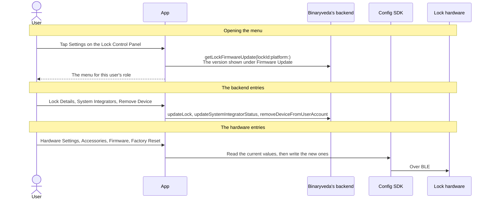

Nothing else is fetched when the menu opens. The lock's name, role, model and serial number all arrive with the lock that Home and the Control Panel already hold.

## 1. Lock Details <span class="chg chg-unchanged">unchanged</span> { #1-lock-details data-toc-label="1. Lock Details" }

Renaming the lock, changing which area of the house it sits in, and changing its photo. All three go out on one mutation, and a new photo is uploaded before it.

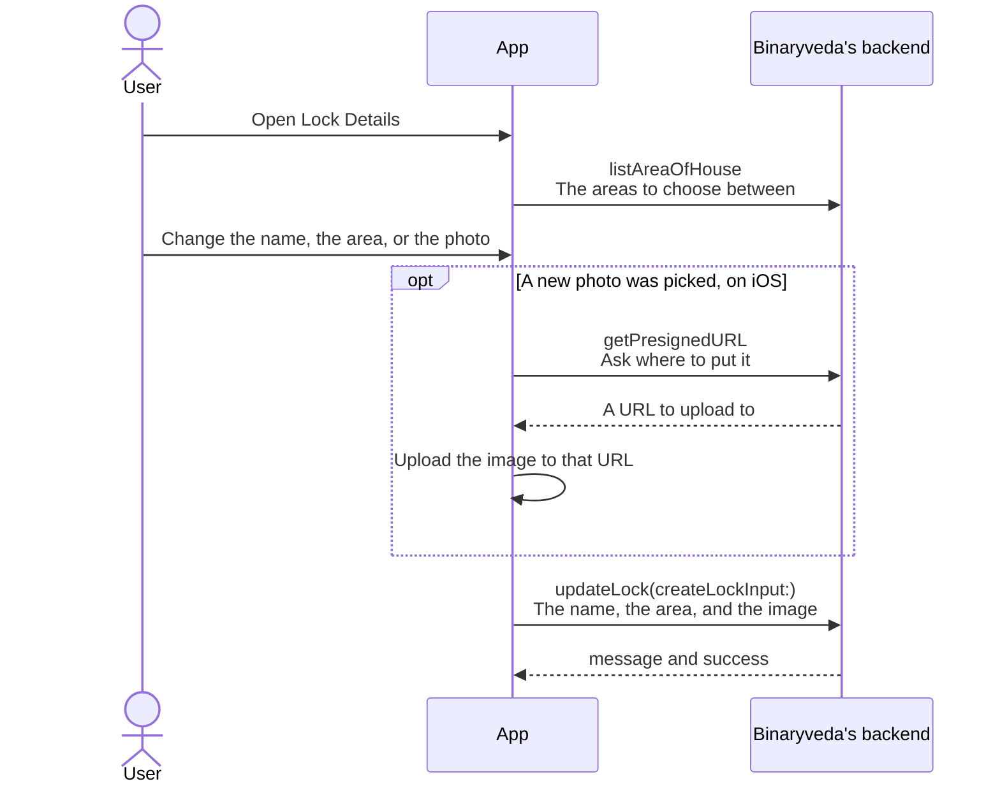

On iOS the photo goes straight to storage rather than through the backend, and only the resulting key travels on `updateLock`. Android has no presigned URL step and sends the image with the mutation.

## 2. My Access <span class="chg chg-changed">changed</span> { #2-my-access data-toc-label="2. My Access" }

### My Access: passcode

The passcode on this screen is the passcode of the **passcode credential bound to this lock**. That credential may also be bound to other locks, if you chose to share it. Changing the digits changes them on every lock it is on, so the screen should say which.

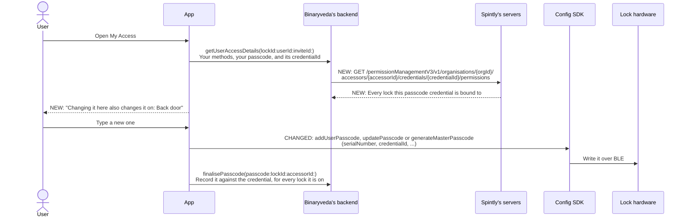

**Every passcode member takes the `credentialId` after the `serialNumber`.** `addUserPasscode` for a first passcode, `updatePasscode` to replace one, `generateMasterPasscode` for the owner's master passcode. On iOS, `updateUserPasscode` and `updateMasterPasscode` take the Android names.

**To change the passcode on this lock only**, when it is shared, split it off first:

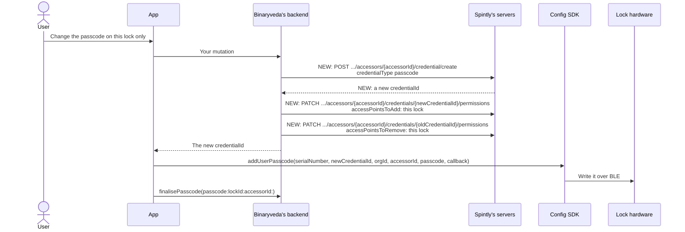

The old passcode keeps working on the other locks. Bind the new credential before unbinding the old one, so the person is never left without a passcode on the lock.

### My Access: fingerprints

Today the list is read off the lock over BLE, and deleting one removes it from the lock. With the Config SDK v3 both go **through Spintly's servers**, so neither needs the phone near the lock.

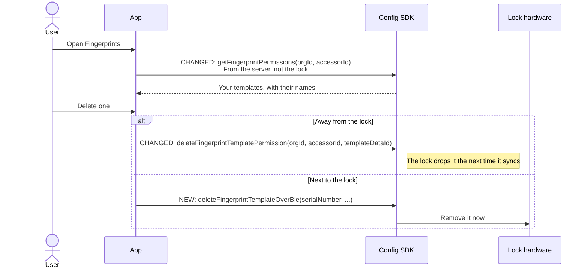

Your screen's notes, that the list "needs the phone near the lock" and that deleting "goes from the lock, not a server", are no longer true. The four-template cap on the lock is unchanged.

### My Access: RFID cards

`listCards` and `deleteRfid` are your own and are unchanged. A card now opens **the lock it was assigned on**, because the SDK binds it there. A card assigned on one lock does not open the person's other locks unless you bind it to them as well.

## 3. Hardware Settings <span class="chg chg-changed">changed</span> { #3-hardware-settings data-toc-label="3. Hardware Settings" }

Everything here is stored **in the lock**, not on the backend, and the screen is blocked when the lock is out of range. All four groups still work the same way: read the current values out of the lock, show them, write the new ones back. Only the members change.

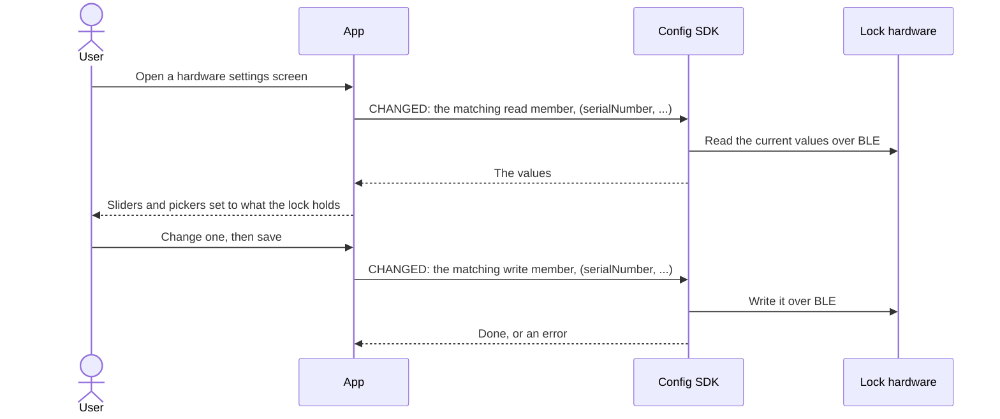

| Setting | Today | Config SDK v3 |
|---|---|---|
| Sound | `readSoundSettings`, `updateLockSoundSettings` | Same names, `(serialNumber, …)`. Each volume 0 to 5 |
| Lights | `readLEDIntensitySettings`, `updateLEDIntensitySettings` | Same names, `(serialNumber, …)`. 1 to 5 |
| Timeout alerts | `readTimeoutAlertSettings`, `updateTamperAlarmSettings`, `updatePrankAlarmSettings`, `updateDOTLSettings` | Same names, `(serialNumber, …)`. **3 to 30 seconds** |
| Lock audio and door bell | `getCurrentLanguageAndDoorbellTone`, `updateVoicePackage`, `setDoorbellTone` | `getCurrentLanguageAndDoorbellTone`, `updateVoicePackage(serialNumber, fileLocation, fileHash, languages, selectedLanguage, tones, selectedTone, voiceUpdateTimeInSec, callback)`, **`updateDoorbellTone`** |

!!! warning "Seconds or minutes"

    The v3 SDK documents the timeout alerts in **seconds, 3 to 30**. Your page describes them in minutes. Which unit the lock uses is being confirmed, see [Still to be confirmed](pending.md).

A voice package is at most 220 KB, and its hash is MD5.


### Changing the lock's audio language

The voice pack still comes from your backend before it goes to the lock. Only the SDK members change.

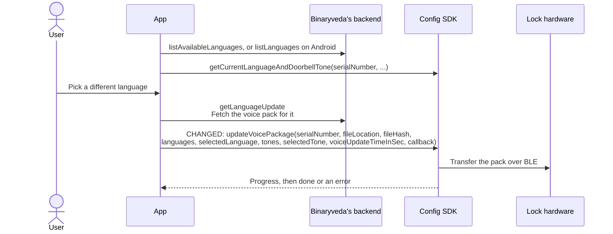

## 4. Accessories <span class="chg chg-changed">changed</span> { #4-accessories data-toc-label="4. Accessories" }

Owner only, and the same two devices: a **BLE Remote** key fob, and a **VDP Module** for a video door phone panel. The Config SDK still treats both as beacons.

### Attaching one

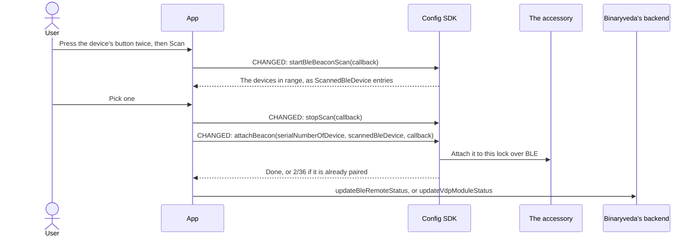

`setBeaconTargetDevice` is gone: the device picked from the scan is passed to `attachBeacon` directly.

### Once it is attached

- **Firmware Update:** `firmwareUpdate(scannedBleDevice, callback)`, then `updateToFirmwareVersion`. A force update for factory-fresh beacons is also available.
- **Factory Reset:** biometric authentication, then `resetBeacon(scannedBleDevice, callback)`, then `removeBleRemote` or `removeVdpModule`.

| Action | Today | Config SDK v3 |
|---|---|---|
| Find one in range | `beaconStartScan`, `setBeaconTargetDevice`, `beaconStopScan` | `startBleBeaconScan(callback)`, `stopScan(callback)`. The scan returns `ScannedBleDevice` entries |
| Tie it to the lock | `startBeaconAttach` | `attachBeacon(serialNumberOfDevice, scannedBleDevice, callback)`. Already paired fails with `2/36` |
| Its firmware | `getListOfFirmwareForBeacon`, `firmwareUpdateToSelectedVersion` | `firmwareUpdate(scannedBleDevice, callback)`, then `updateToFirmwareVersion` |
| Wipe it | `resetBeacon` | `resetBeacon(scannedBleDevice, callback)` |

## 5. Firmware Update <span class="chg chg-changed">changed</span> { #5-firmware-update data-toc-label="5. Firmware Update" }

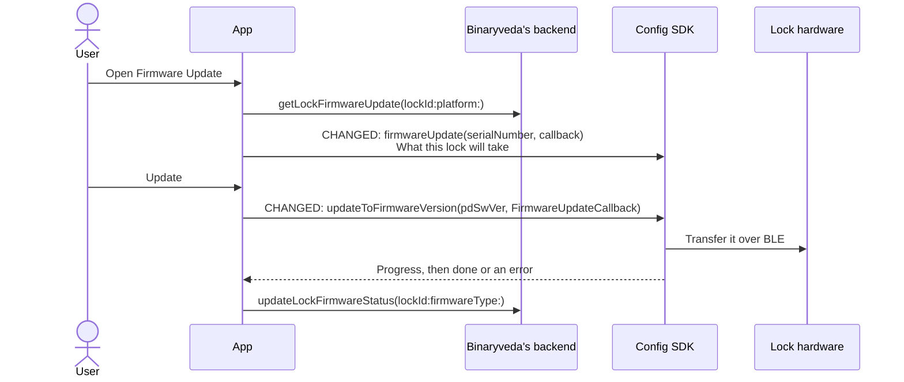

## 6. System Integrators <span class="chg chg-unchanged">unchanged</span> { #6-system-integrators data-toc-label="6. System Integrators" }

Third party services that have been given access to the lock. **They are not invited from this app.** Linking starts in the integrator's own application, and this screen only switches an already linked integrator on or off for one lock.

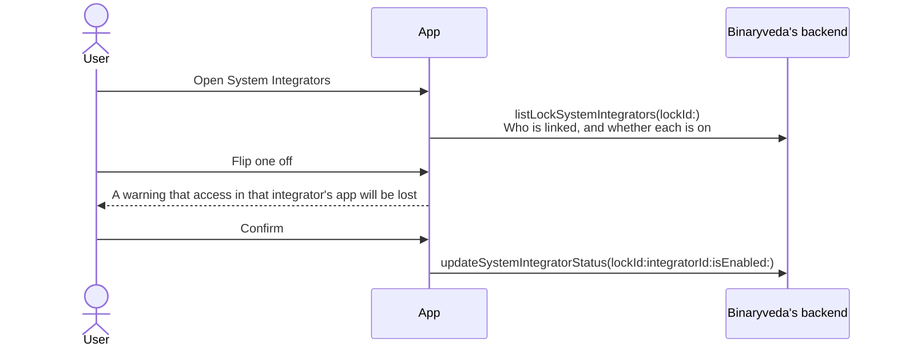

The switch is per lock, so turning an integrator off here leaves it on for every other lock it was linked to.

## 7. Voice Assistants <span class="chg chg-unchanged">unchanged</span> { #7-voice-assistants data-toc-label="7. Voice Assistants" }

Alexa and Google Home, switched on or off for this lock. Linking the account itself happens under Profile rather than here, and this screen only decides whether an already linked assistant may act on this lock. It goes out on `updateVoiceAssistancePreferences`.

Voice commands can read whether a lock is locked or unlocked, read its mode, and unlock it. There is no command to lock.

## 8. Factory Reset and Remove Device <span class="chg chg-changed">changed</span> { #8-factory-reset-and-remove-device data-toc-label="8. Factory Reset and Remove Device" }

=== "Factory Reset"

    ```mermaid
    sequenceDiagram
        actor U as User
        participant A as App
        participant C as Config SDK
        participant L as Lock hardware
        participant B as Binaryveda's backend
        participant S as Spintly's servers

        U->>A: Factory Reset, then confirm
        U->>A: Pass biometric authentication
        A->>C: CHANGED: resetDevice(serialNumber, callback)
        C->>L: Wipe the lock over BLE
        C-->>A: Done, or an error
        A->>B: updateLockConfigurationStatus(lockId:lockConfigurationStatus:)
        A->>B: removeLock(lockSerialNumber:)
        B->>S: DELETE /infrastructureManagement/internal/v1/<br/>accessPoints/{accessPointId}
        Note right of S: Every credential bound to this lock<br/>is unbound from it
        A-->>U: Back to Home, with the lock gone
    ```

    Only the SDK member changes. Deleting the access point removes every binding on it, so passcodes shared with the lock keep working on the other locks they are bound to.

    A reset through the gateway, `remoteResetDevice(serialNumber, callback)`, is planned.

=== "Remove Device"

    ```mermaid
    sequenceDiagram
        actor U as User
        participant A as App
        participant B as Binaryveda's backend
        participant S as Spintly's servers

        U->>A: Remove Device, then confirm
        A->>B: removeDeviceFromUserAccount(lockId:)
        B->>S: CHANGED: PATCH /permissionManagementV3/v1/organisations/{orgId}/<br/>accessPoints/{accessPointId}/credential-permissions<br/>credentialsToRemove: [{ accessorId }]
        Note right of S: Everything this person has on this lock goes.<br/>Their other locks are untouched
        A-->>U: Back to Home
    ```

    The same call an owner uses to remove someone from one lock in [User Management](user-management.md#6-managing-users-afterwards), with the person's own `accessorId`. A passcode they share with another lock keeps working there.

## 9. About Lock, FAQs, Manual and Get Help <span class="chg chg-unchanged">unchanged</span> { #9-about-lock-faqs-manual-and-get-help data-toc-label="9. About Lock, FAQs, Manual and Get Help" }

The four read only entries.

| Entry | Where its content comes from |
|---|---|
| About Lock | The lock the app already holds, for the device name, model name and number, and serial number. The fingerprint count comes from getFingerprintPermissions(orgId, accessorId), which with the Config SDK v3 reads Spintly's servers rather than the lock |
| FAQs | getFaqs |
| Manual | getProductManualLink, keyed on the lock's model id, opened in a web view |
| Get Help | createSupportTicket, then listSupportTickets and viewSupportTicket on iOS |

Only the source of the fingerprint count changes, as in [My Access](#my-access-fingerprints).

## The Wi-Fi Gateway <span class="chg chg-changed">changed</span> { #the-wi-fi-gateway data-toc-label="The Wi-Fi Gateway" }

**The gateway is not a Lock Settings entry.** It is a device of its own, added during onboarding and managed from its own card on Home. It is covered here because it is the third piece of hardware the Config SDK writes to, and because its firmware works differently from everything else on this page.

The gateway bridges the lock to the internet. It is what makes a lock report Online or Offline, what carries push notifications while the user is away, and what the remote unlock falls back to when Bluetooth is out of range.

### Adding one, and changing its network

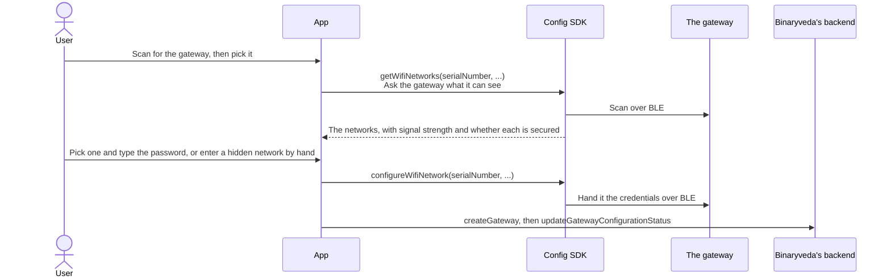

**The gateway does the scanning, not the phone.** The network list is whatever the gateway can reach from where it is plugged in, which is the point.

A hidden network is typed in by hand, with its security type picked from a list. Failures come back as the access point not being found, or the password being wrong.

### Gateway settings

Six entries, from the gateway's card on Home: **Edit Module Name**, **Connections**, **Wi-Fi Network**, **About**, **Firmware Update** and **Factory Reset**. The last two are owner only.

Opening the settings reads the gateway itself with `getGateway`, which is what About is drawn from. Connections lists the locks this gateway serves, from `listConnections`. Renaming goes out on `updateGateway`.

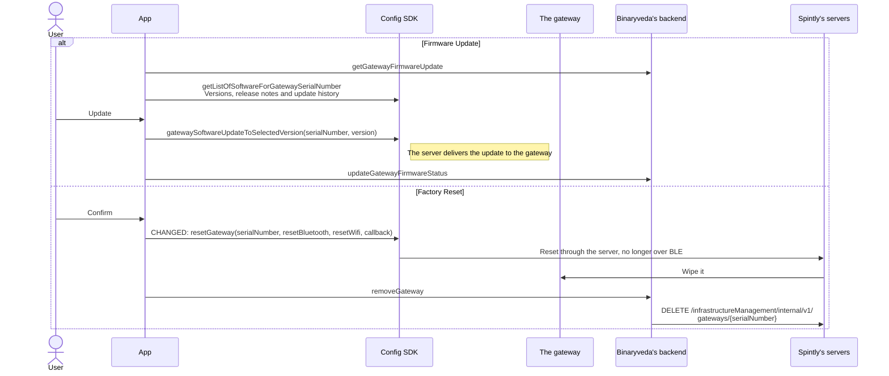

| Action | Today | Config SDK v3 |
|---|---|---|
| Networks and credentials | `getWifiNetworks`, `configureWifiNetwork` | Same names, `(serialNumber, …)` |
| Gateway software | `getListOfSoftwareForGatewaySerialNumber`, `gatewaySoftwareUpdateToSelectedVersion` | Same names |
| Reset | `resetGateway`, over BLE | **`resetGateway(serialNumber, resetBluetooth, resetWifi, callback)` now resets through the server.** A BLE reset is planned as `resetGatewayOverBle` |

!!! warning "Same name, opposite route"

    Your gateway factory reset calls `resetGateway` over BLE and then `removeGateway`. In v3 the same name sends the reset through the server instead. Keep that in mind when you move to v3, until `resetGatewayOverBle` ships.

## Differences between the two

The role and menu differences on your page are unchanged. The v3 SDK removes the naming differences:

| | Today | After |
|---|---|---|
| Replace a user passcode | iOS `updateUserPasscode`, Android `updatePasscode` | `updatePasscode` on both |
| Replace the master passcode | iOS `updateMasterPasscode`, Android `generateMasterPasscode` | `generateMasterPasscode` on both |

## Every SDK member this flow uses

Config SDK v3, Android form. All of them need `setAuthToken` and `initiateSdk()` first.

| Member | When | What it is for |
|---|---|---|
| `addUserPasscode(serialNumber, credentialId, orgId, accessorId, passcode, callback)` | My Access | Write a first passcode |
| `updatePasscode(serialNumber, credentialId, orgId, accessorId, oldPasscode, newPasscode, callback)` | My Access | Replace one |
| `generateMasterPasscode(serialNumber, credentialId, orgId, accessorId, oldPasscode, newPasscode, callback)` | My Access | Replace the owner's master passcode |
| `getFingerprintPermissions(orgId, accessorId)` | My Access | List the person's fingerprints, from the server |
| `deleteFingerprintTemplatePermission(orgId, accessorId, templateDataId)` | My Access | Delete one at the server. The lock drops it on its next sync |
| `deleteFingerprintTemplateOverBle(serialNumber, …)` | My Access | Delete one from the lock now |
| `readSoundSettings`, `updateLockSoundSettings` | Sound | `(serialNumber, …)` |
| `readLEDIntensitySettings`, `updateLEDIntensitySettings` | Lights | `(serialNumber, …)` |
| `readTimeoutAlertSettings`, `updateTamperAlarmSettings`, `updatePrankAlarmSettings`, `updateDOTLSettings` | Timeout Alerts | `(serialNumber, …)` |
| `getCurrentLanguageAndDoorbellTone`, `updateVoicePackage`, `updateDoorbellTone` | Lock Audio and Door Bell | `(serialNumber, …)` |
| `firmwareUpdate`, `updateToFirmwareVersion` | Firmware Update, and accessories | Versions, then the transfer |
| `startBleBeaconScan`, `stopScan`, `attachBeacon`, `resetBeacon` | Accessories | Find, attach, wipe |
| `resetDevice(serialNumber, callback)` | Factory Reset | Wipe the lock |
| `getWifiNetworks`, `configureWifiNetwork` | Gateway | `(serialNumber, …)` |
| `getListOfSoftwareForGatewaySerialNumber`, `gatewaySoftwareUpdateToSelectedVersion` | Gateway | Unchanged |
| `resetGateway(serialNumber, resetBluetooth, resetWifi, callback)` | Gateway | Reset through the server |
