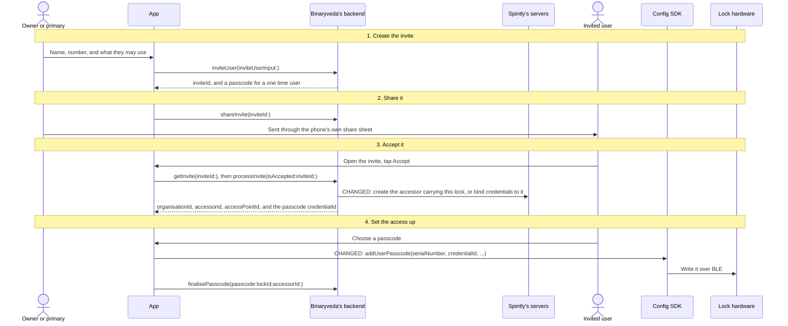
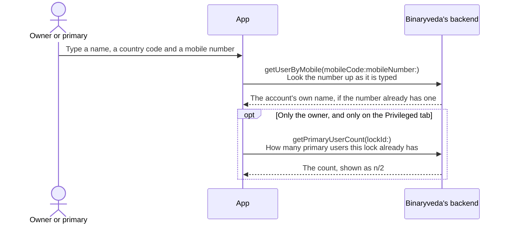
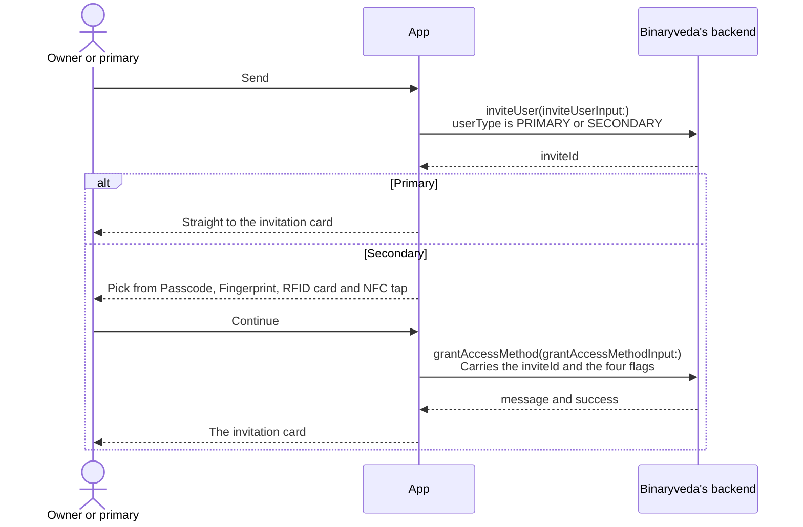
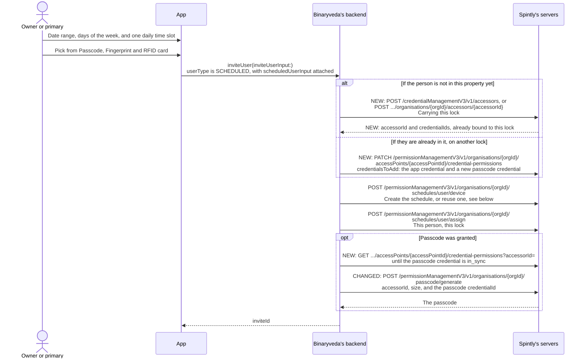
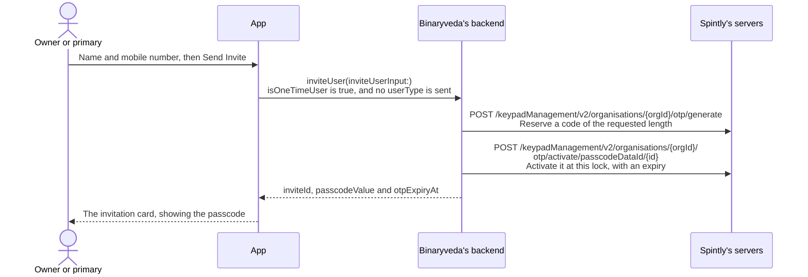
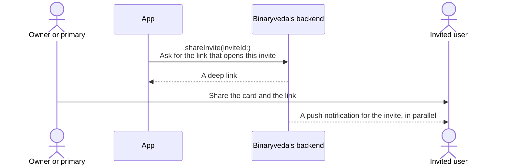
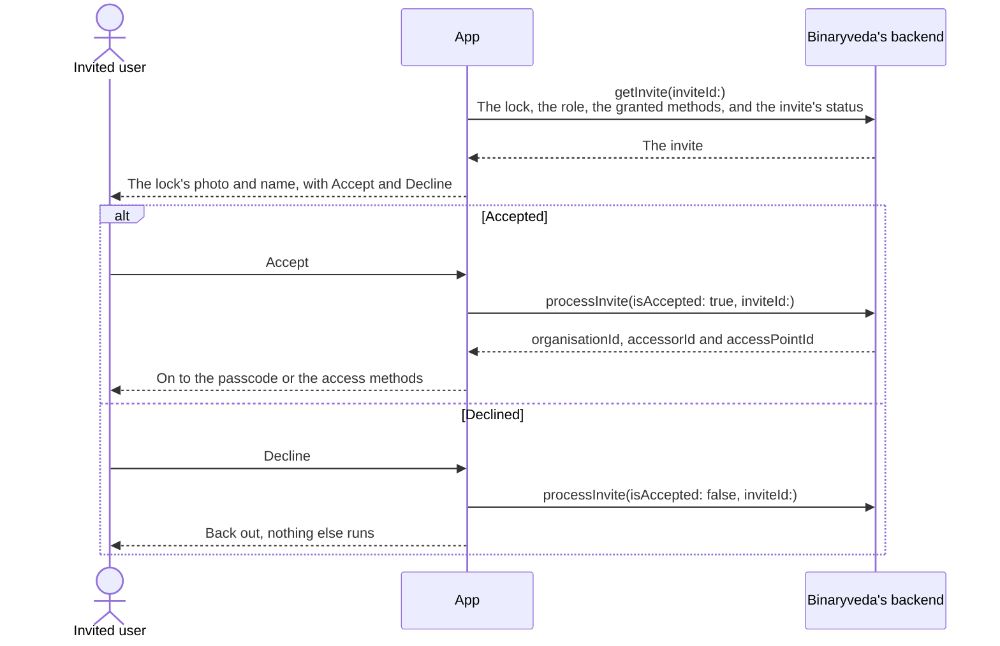
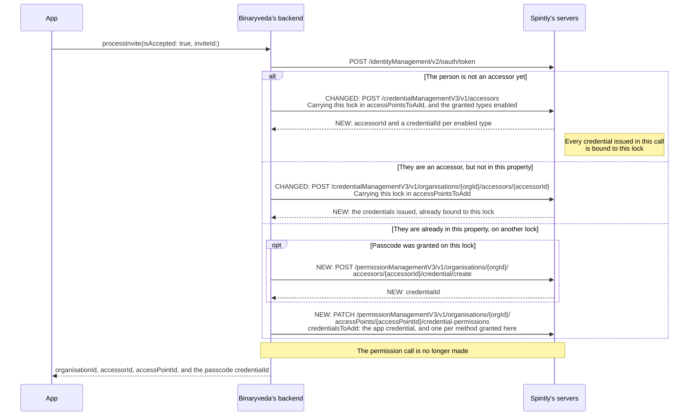
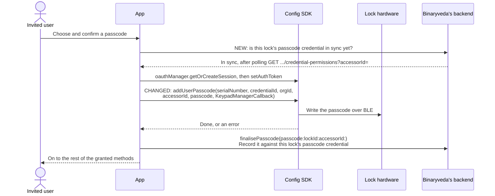
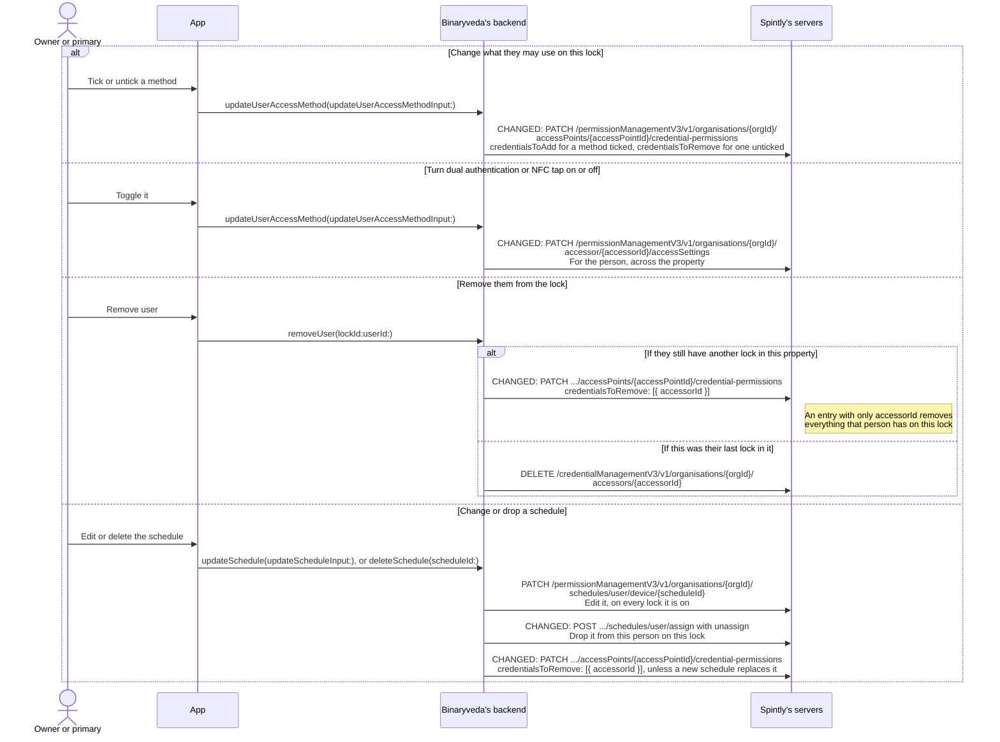

# 5. User Management

**What it is.** Your User Management flow, with the changes needed when a person can hold several credentials and be on several locks in the same property.

Access is still granted **per lock**, and inviting the same person to a second lock is still a second invite. What changes is how a lock is granted at Spintly: **the person's credentials are bound to the lock**, one per method they were given on it.

!!! warning "Key point"

    `PATCH .../accessors/{accessorId}/permissions` is refused for properties on the new model. Every place this page uses it today (accepting an invite, changing a user's methods, removing a user from a lock) moves to the credential binding calls described in [Spintly API changes](api-changes.md).

## What changes

| Section | | What changes |
|---|---|---|
| 1. Creating the invite | changed | Primary, secondary and one time: unchanged. Scheduled: bind first, then the schedule, then `passcode/generate` with a `credentialId` |
| 2. Sharing the invite | unchanged | |
| 3. Accepting the invite | changed | The lock goes on the accessor call, or credentials are bound. No permission call |
| 4. Setting the passcode | changed | `addUserPasscode` takes the `credentialId` bound to this lock |
| 5. The other access methods | changed | Fingerprint: bind, then enrol. Card: bound as it is assigned. NFC tap and dual authentication apply to the person across the property |
| 6. Managing users afterwards | changed | Methods become bindings. Removing someone from one lock is one binding call. Schedules are one per person per lock |

## Participants

This page uses Owner or primary, Invited user, App, Config SDK, Lock hardware, Binaryveda's backend, and Spintly's servers, as defined in [Reading these pages](conventions.md).

## How a method on a lock maps to Spintly

Your invite grants methods per lock: app access always, plus `passcode`, `fingerprint`, `card` and `mobileNfc`. At Spintly each one becomes a binding on that lock, or a setting of the person.

| Granted on this lock | At Spintly |
|---|---|
| App access, always | Bind the person's **app credential** to the lock |
| Passcode | Bind a **passcode credential** to the lock: the one issued with the person's accessor if it is not on any lock yet, otherwise a new one from `credential/create`. Use a fresh passcode credential for each lock: a passcode is never copied between locks. The person then sets the digits with `addUserPasscode` |
| Fingerprint | Nothing when the invite is accepted. The fingerprint credential is bound just before a finger is enrolled |
| RFID card | Nothing when the invite is accepted. The card is bound to the lock as it is assigned at the lock |
| NFC tap | `tapToAccess` on the **person's** access settings. It applies on every lock where they have app access, not on one lock |

**Access settings still decide which credential types a person may have.** Enable a type when it is first granted on any of the person's locks in the property. The first time a type is enabled, its credential is created and returned in the response. Leave it enabled while any of their locks still uses it.

**Unticking a method on one lock is an unbind on that lock.** The access setting stays as it is.

## The whole flow

## 1. Creating the invite changed { #1-creating-the-invite data-toc-label="1. Creating the invite" }

The inviter opens **Users** on the Lock Control Panel, picks a tab, and fills in a name and a mobile number. Everything after that depends on the kind of user.

Only a mobile number is collected. No email address is used anywhere in this flow.

### The identity step, common to all four unchanged { #the-identity-step data-toc-label="The identity step, common to all four" }

When the number already belongs to an account, the name comes back from the lookup and is used instead of the typed one.

### Primary and secondary unchanged { #primary-and-secondary data-toc-label="Primary and secondary" }

**A primary user skips the access method step.** They implicitly get every method, so the app goes straight from the invite to the card.

**App access is not one of the four.** `grantAccessMethod` carries only `passcode`, `fingerprint`, `card` and `mobileNfc`. Opening the lock from the app comes with the invite itself and cannot be turned off here.

**Nothing reaches Spintly until the invite is accepted.** What the four flags turn into at Spintly is the table in [How a method on a lock maps to Spintly](#how-a-method-on-a-lock-maps-to-spintly), applied in step 3.

### Scheduled changed { #scheduled data-toc-label="Scheduled" }

Today the schedule is created and assigned first, then `passcode/generate` runs. Two things change:

- **A schedule only attaches to credentials that are on the lock.** Assigning a schedule to a person on a lock where they have no credential bound fails with `400 "No credentials are bound to this access point for this user"`. So the person's credentials go on the lock **first**.
- **A generated passcode belongs to a passcode credential.** `passcode/generate` now takes the `credentialId` whose digits it sets.

**A schedule is per person, per lock.** A person can be on different schedules on different locks. On any one lock they have **one** schedule: assigning another on the same lock **replaces** it. Your **Add New Schedule**, on a lock where the person already has a schedule, becomes *edit* or *replace*.

**The same schedule on a second lock:** `credential/create` for a new passcode credential, bind it and the app credential to the second lock, assign the schedule there, then `passcode/generate` with the **new** `credentialId`. The second lock gets its own passcode, because a passcode is never copied between locks.

The second lock can use the **same `scheduleId`**. Editing that schedule then changes it on both locks. See [Managing users afterwards](#6-managing-users-afterwards).

A lock's schedule applies to everything the person has bound on it, app access included, and to anything bound there later.

### One time unchanged { #one-time data-toc-label="One time" }

The one time code involves no accessor, credential or schedule, so nothing about it changes.

There is no access method step and no schedule step. The passcode comes back from the backend already generated, and the app shows the inviter that it is valid for **6 hours**. The countdown in the user list is worked out from `otpExpiryAt`.

A one time user who has been used up can be sent a fresh code with **Invite Again**, which runs the same mutation again with the same name and number.

## 2. Sharing the invite unchanged { #2-sharing-the-invite data-toc-label="2. Sharing the invite" }

The app builds an invitation card showing the lock, the role, the granted methods, and the passcode when there is one. Sharing it is one query and then the phone's own share sheet, so the invite can go out over any messaging app.

The invited user can arrive either way: by tapping the push notification, or by opening the shared link. Both land on the same screen with the same invite id.

## 3. Accepting the invite changed { #3-accepting-the-invite data-toc-label="3. Accepting the invite" }

### In the app unchanged { #accept-in-the-app data-toc-label="In the app" }

The invited user opens the invite, the app fetches it, and they accept or decline.

Until they accept, the invite is only a record on Binaryveda's backend and the lock knows nothing about them. Accepting is what creates them at Spintly as an accessor and grants them access at that lock.

An invite is only actionable while it is **active**. The status comes back on `getInvite`, and a revoked, accepted, rejected or expired invite is shown as a message instead of the Accept and Decline buttons.

The three ids that come back are Spintly's, and they are what the Config SDK needs in the next step.

### What accepting does at Spintly changed { #what-accepting-does-at-spintly data-toc-label="What accepting does at Spintly" }

Today accepting creates the accessor or registers it in the organisation, and then grants the lock with `PATCH .../accessors/{accessorId}/permissions`. The grant now happens **on the accessor call itself**, or, when the person is already in the property, by **binding their credentials**.

**Wait for `accessor_ready`** after the first two branches before binding anything else for that person, as in [Lock Onboarding](lock-onboarding.md#1-choose-a-property).

**What to bind in the third branch** is the table in [How a method on a lock maps to Spintly](#how-a-method-on-a-lock-maps-to-spintly): always the app credential, plus a passcode credential when passcode was granted. Fingerprint and card are bound later, at the lock.

**Return the passcode `credentialId` to the app.** `spintlyDetails(lockSerialNumber:)` should carry it too, so that the invited user's setup in step 4, and My Access later, can pass it to the Config SDK.

### Setting the new access up, straight after accepting unchanged { #setting-the-new-access-up data-toc-label="Setting the new access up" }

Accepting grants the access but does not finish the job, so the app keeps the new user in the flow and walks them through whatever they were given. Which screen comes first depends on their role.

- A **primary** user goes to the passcode screen first, since choosing a passcode is the one thing every primary user does, and then on to anything else they were granted.
- A **secondary** user goes straight to the list of granted methods, with the passcode sitting in that list when it was granted.
- A **scheduled** user is treated as a secondary user on iOS. On Android the flow stops here and the app returns Home, which is covered in Differences.

Before showing that list, both platforms ask the backend which methods were actually granted, with `getUserAccessDetails`. On this path only the invite id is filled in, since the person does not have a user id on this lock yet. If nothing was granted, the screen is skipped.

## 4. Setting the passcode changed { #4-setting-the-passcode data-toc-label="4. Setting the passcode" }

**Wait until the binding from step 3 is `in_sync`** before writing, as in [When a binding reaches the lock](api-changes.md#when-a-binding-reaches-the-lock).

**`credentialId` is the passcode credential bound to this lock in step 3.** It is this lock's own passcode credential, so the passcode chosen here works on this lock only.

## 5. The other access methods changed { #5-the-other-access-methods data-toc-label="5. The other access methods" }

Fingerprint and RFID work as in [Lock Onboarding, step 8](lock-onboarding.md#8-fingerprint-and-rfid):

- **Fingerprint:** if the person has no fingerprint credential yet, enable `fingerprintAccess` on their access settings: the response returns the new credential. Then bind it to the lock, if it is not already on it, wait until it is `in_sync`, then enrol with `performFPEnrollmentOnDevice(serialNumber, credentialId, …)`. A person has one fingerprint credential for all their locks and enrols fingers lock by lock, see [One fingerprint credential, many fingers](lock-onboarding.md#one-fingerprint-credential-many-fingers).
- **RFID card:** `assignCardToAccessorWithPermission(serialNumber, orgId, accessorId, accessPointId, CREDENTIAL_PERMISSION, true, …)` assigns the card and binds it to this lock.

**NFC tap and dual authentication now belong to the person.** Both are settings of the person, applied on every lock they open from the app in the property. Turning dual authentication on for a user from one lock's screen turns it on for them on all of that property's locks. Your user detail screen should say so.

## 6. Managing users afterwards changed { #6-managing-users-afterwards data-toc-label="6. Managing users afterwards" }

**Changing methods sends only the change.** Ticking passcode binds a passcode credential for this lock (a new one from `credential/create` if the person's first one is already on another lock), and the person then sets it. Unticking passcode unbinds that credential from this lock.

**Removing someone from one lock is one call.** Send an entry with only the `accessorId` in `credentialsToRemove`, and everything the person has on that lock goes: app access, passcodes, fingerprints and cards, including any added at the lock that your backend never recorded. Their other locks are untouched.

**Removing them from their last lock** in the property is the `DELETE` it is today, including `isAccessorDeleted` in the response.

### Schedules

**Edit** changes the schedule itself, on every lock and for every person it is assigned to. If a schedule is shared across locks, your edit screen should say which.

**Dropping a schedule from one lock** is `schedules/user/assign` with an `unassign` entry for that person and that lock. `DELETE .../schedules/user/device/{scheduleId}` removes the schedule from **every** lock and person it is on, so use it only when nothing should use it any more.

!!! danger "A scheduled user without a schedule has unrestricted access"

    Unassigning a schedule leaves the person's credentials on the lock with **no time limit**. Whenever you drop a scheduled user's schedule on a lock, **in the same flow** either remove their credentials from that lock (`credentialsToRemove: [{ accessorId }]`) or assign the schedule that replaces it. Your "drop the schedule, keep the user" action has to become one of the two.

**Removing a scheduled user** follows the same rule: remove them from the lock as above, and unassign their schedule there. Delete the schedule only if it is not shared with another lock or person.

## Differences between the two

The platform differences on this page are unchanged. Two now matter more:

| | iOS | Android |
|---|---|---|
| A scheduled user's access methods on `inviteUser` | Sent afterwards on `grantAccessMethod` | Sent inside `scheduledUserInput` |
| Where a scheduled invitee lands after accepting | The granted methods screen | Home |

Whichever platform sent them, your backend needs the methods **before** it binds and assigns the schedule, because the schedule only attaches to credentials already on the lock.

## Every SDK member this flow uses

| SDK | Member | When | What it is for |
|---|---|---|---|
| OAuth | `oauthManager.getOrCreateSession` | Before the passcode write | Unchanged |
| Config | `setAuthToken(token)` | Before the passcode write | Unchanged |
| Config | `addUserPasscode(serialNumber, credentialId, orgId, accessorId, passcode, KeypadManagerCallback)` | The invited user sets their passcode | **Changed.** Write the passcode for this lock's passcode credential |
| Config | `performFPEnrollmentOnDevice(serialNumber, credentialId, …)` | Fingerprint, in step 5 | **Changed.** As in Lock Onboarding |
| Config | `assignCardToAccessorWithPermission(serialNumber, …, accessPointId, CREDENTIAL_PERMISSION, …)` | RFID, in step 5 | **Changed.** As in Lock Onboarding |
